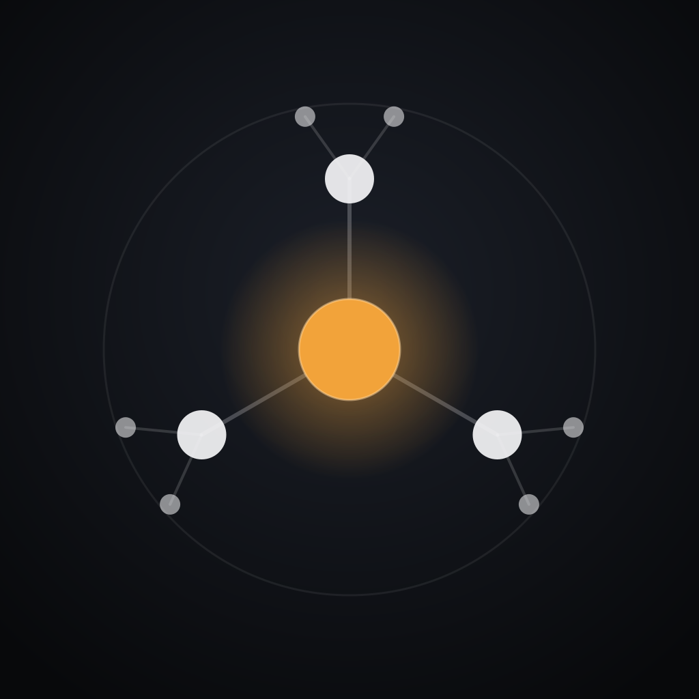
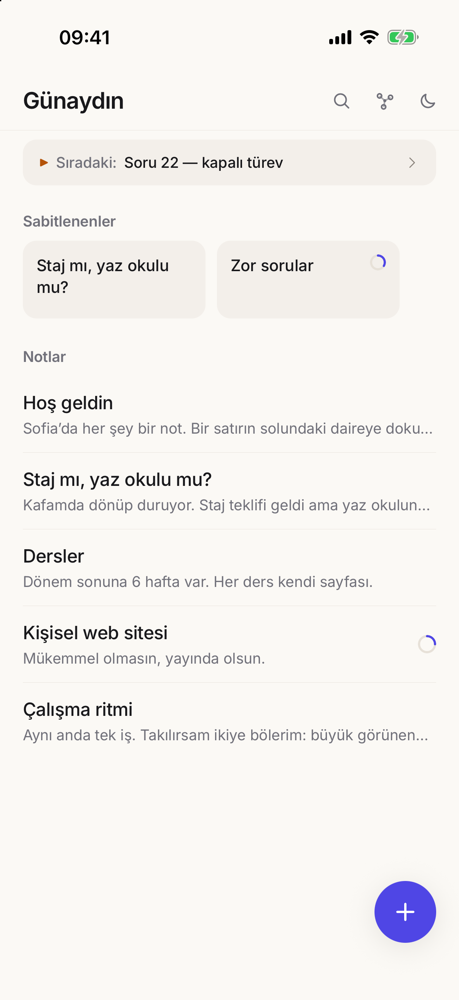
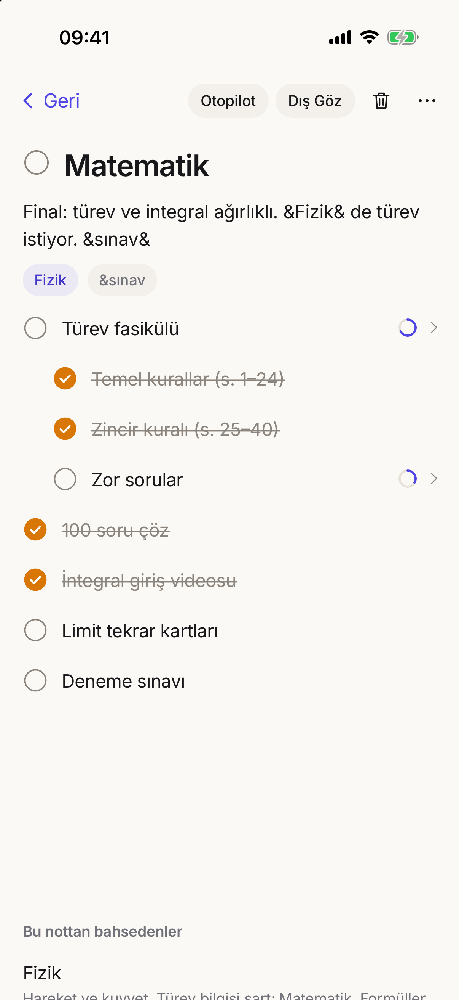
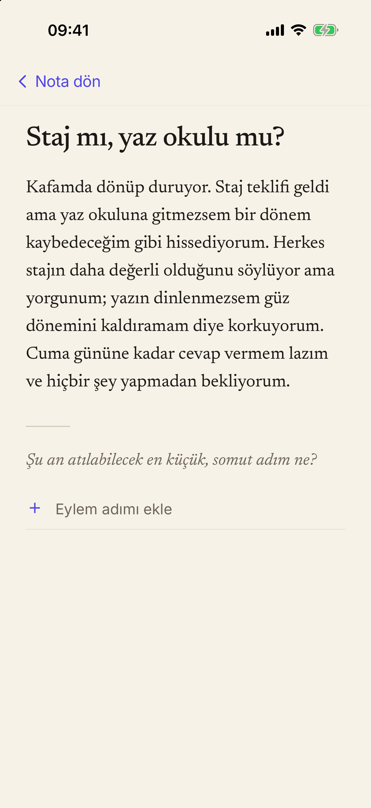
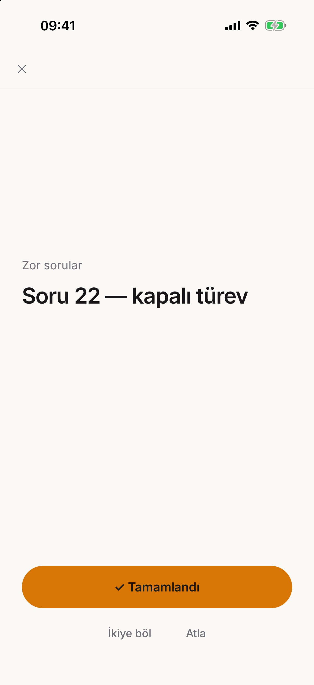
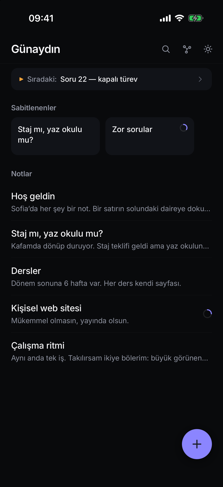
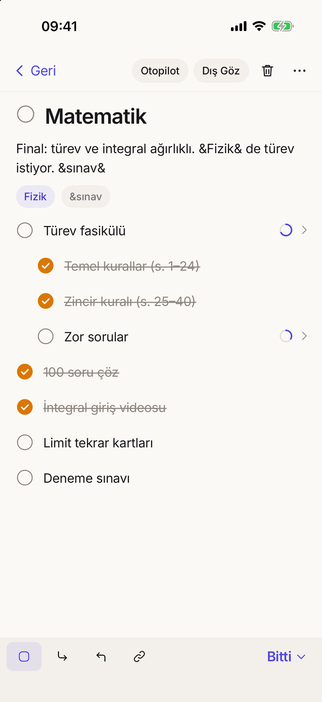
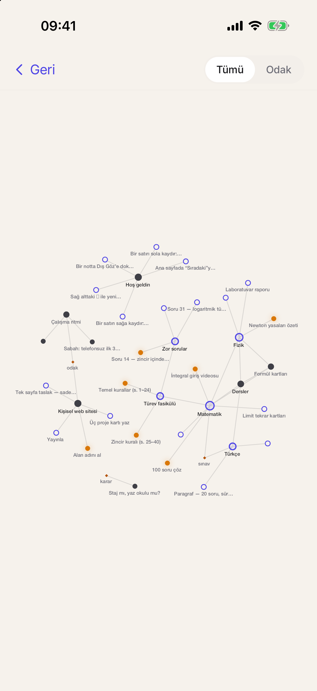
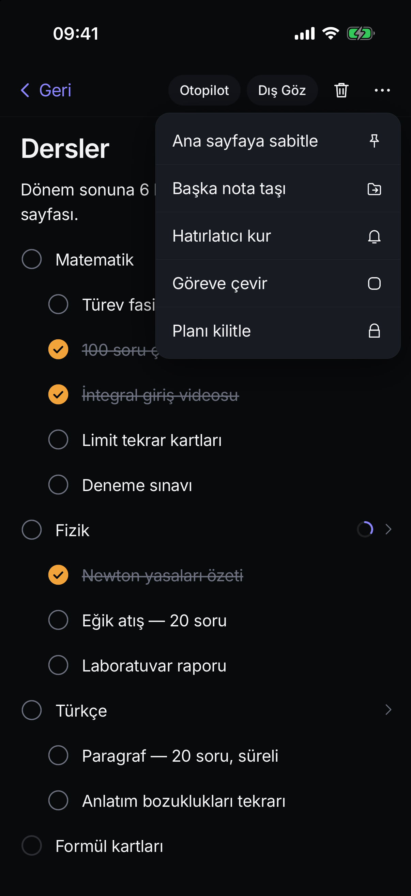
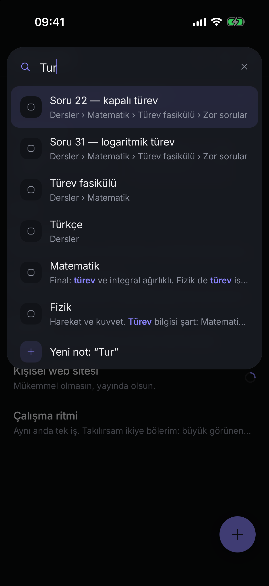

<p align="center">
  
</p>

<h1 align="center">Sofia Cortex</h1>

<p align="center">
  Sakin bir not ve görev uygulaması.<br/>
  Yaz, içine gir, böl, tikle — ve iş yapma zamanı geldiğinde tek bir şeye odaklan.
</p>

<p align="center">
  
  
  
  
</p>

---

## Fikir

Her şey bir not. Bir not görev olabilir; içine girdiğinde kendi sayfası olur, içine yeni notlar ve
görevler eklersin — derinlik sınırsız. Alt görevlerin hepsi bitince üstteki görev kendiliğinden
tiklenir; biri geri açılırsa o da açılır.

İki küçük alışkanlık işi kolaylaştırır:

- **Dış Göz** — notunu, bir kitap sayfası gibi dizilmiş hâlde, başkasının yazısını okur gibi
  okursun. Altında tek bir soru: *“Şu an atılabilecek en küçük, somut adım ne?”* Yazdığın her adım
  o notun altına görev olarak eklenir.
- **Otopilot** — ekranda yalnızca sıradaki tek görev kalır. *Tamamlandı*'ya basarsın, sıradaki
  kendiliğinden gelir. Büyük geldiyse *İkiye böl*.

Yapay zekâ yok, hesap yok, sunucu yok. Her şey telefonda, SQLite'ta.

## Ekranlar

<table>
<tr>
<td width="33%"><br/><sub><b>Ana sayfa.</b> Tek satırlık “Sıradaki”, sabitlenenler, notlar. Yeni not için sağ alttaki ＋.</sub></td>
<td width="33%"><br/><sub><b>Koyu tema.</b> Sağ üstteki ay/güneş ile değişir; basılı tutunca Ayarlar.</sub></td>
<td width="33%"><br/><sub><b>Not.</b> Başlık, metin ve satırlar yerinde düzenlenir. Alt görevler bitince üst görev kendiliğinden tiklenir.</sub></td>
</tr>
<tr>
<td><br/><sub><b>Yazarken.</b> Klavyenin üstünde: Görev · Altına al · Üste çıkar · Bağla · Bitti. Return yeni satır açar.</sub></td>
<td><br/><sub><b>Dış Göz.</b> Kendi notun, dokunulmadan, sakin bir sayfada. Altında tek soru ve eylem adımları.</sub></td>
<td><br/><sub><b>Otopilot.</b> Tek görev. Tamamlandı · İkiye böl · Atla.</sub></td>
</tr>
<tr>
<td><br/><sub><b>Graf.</b> Notlar ve aralarındaki bağlantılar. Dengeye oturunca fizik durur.</sub></td>
<td><br/><sub><b>••• menüsü.</b> Sabitle, taşı, hatırlatıcı, görev/not, planı kilitle.</sub></td>
<td><br/><sub><b>Arama.</b> Aksan-duyarsız: “tur” yazınca “Türev” de bulunur.</sub></td>
</tr>
</table>

## Kullanım

| | |
|---|---|
| Yeni not | Sağ alttaki ＋. Başlık yazılmaya hazır gelir; Return gövdeye geçer. Boş bırakılan not kendiliğinden silinir. |
| Görev yapmak | Satırın solundaki soluk daireye dokun ya da klavye çubuğundaki ☐. |
| Yeni satır | Satırdayken Return. Boş bir görevde Return veya ⌫ onu düz metne çevirir. Sayfanın boş kısmına dokunmak da yeni satır açar. |
| Alt görev | Satırı sağa kaydır ya da ↳ Altına al. |
| Silmek | Satırı sola kaydır ya da üst bardaki çöp kutusu. Hemen çıkan *Geri al* ile tek dokunuşta geri gelir. |
| Bağlantı | Klavye çubuğunda *Bağla* ya da `&` yaz: `&Fizik&`. Böyle bir not varsa bağlantıdır, yoksa etiket olur. |
| Sabitlemek, taşımak, hatırlatıcı | Notun üst barındaki •••. Hatırlatıcı istenirse bildirime dokununca doğrudan Otopilot'ta açılır. |
| Planı kilitlemek | ••• → Planı kilitle. Görevler bitene kadar sıralama ve yapı değişmez, sadece tiklenir. |

## Mimari

```
Expo SDK 58 · React Native 0.88 (New Architecture) · TypeScript strict
expo-sqlite (WAL + FTS5) · @shopify/react-native-skia (graf)
Reanimated 4 · Gesture Handler 3 · react-native-keyboard-controller
```

Motor (`src/engine`) saf TypeScript'tir; React ya da Expo içermez, depolamaya dört metotluk bir
arayüzle erişir — telefonda expo-sqlite, testlerde `bun:sqlite`. SQLite asıl kaynaktır; ekranlar her
şeyi bellekteki bir kopyadan senkron okur, bu yüzden hiçbir kare diski beklemez. Her değişiklik tek
bir işlem olarak kaydedilir; geri al / yinele bu sayede tek adımdır.

Ayrıntılar: [`ARCHITECTURE.md`](ARCHITECTURE.md) · çalışma kuralları: [`CLAUDE.md`](CLAUDE.md) ·
tasarım yönü: [`docs/design-direction.md`](docs/design-direction.md)

**Ölçülen performans (10 000 not):** açılışta yükleme ~15 ms · tikleme ve yukarı yayılma ~0.07 ms ·
arama ~0.9 ms · graf fizik adımı ~6 ms. `bun test` → 94 test.

## Kurulum

Gereksinimler: macOS, Xcode, Node ≥ 20, CocoaPods, [bun](https://bun.sh) (testler için).

```bash
git clone https://github.com/cleoanka/sofia-cortex.git
cd sofia-cortex
npm install
bun test
npx expo run:ios                     # simülatör
```

### iPhone'a kurmak

1. iPhone'u USB ile bağla, *Bu bilgisayara güven* de; **Ayarlar → Gizlilik ve Güvenlik →
   Geliştirici Modu**'nu aç.
2. `app.json` → `expo.ios.appleTeamId` alanına kendi Team ID'ni yaz, `bundleIdentifier`'ı benzersiz
   yap. Ücretsiz Apple hesabı da olur: uygulama yalnızca yerel bildirim kullanır ve
   `plugins/withLocalNotificationsOnly.js` push yetkisini kaldırır.
3. Derle ve kur:
   ```bash
   npx expo prebuild --platform ios
   cd ios && xcodebuild -workspace SofiaCortex.xcworkspace -scheme SofiaCortex \
     -configuration Release -destination "id=<UDID>" -allowProvisioningUpdates build
   xcrun devicectl device install app --device <UDID> build/Build/Products/Release-iphoneos/SofiaCortex.app
   ```
4. İlk açılışta **Ayarlar → Genel → VPN ve Cihaz Yönetimi** altında geliştirici sertifikana güven.

## Nasıl yapıldı

Claude Opus 5.5 uygulamayı yazdı ve her ekranı simülatörde ekran görüntüsüyle kontrol etti. `agy`
üzerinden **Gemini 4 Argon** fizik motorunu, bir mimari/performans incelemesini
([`docs/design-review-2026-11-01.md`](docs/design-review-2026-11-01.md)) ve sade tasarım yönünü
([`docs/design-direction.md`](docs/design-direction.md)) üretti; **Gemini 3.8 Flash** sınır durumu
testlerini yazdı.

## Lisans

MIT
