<p align="center">
  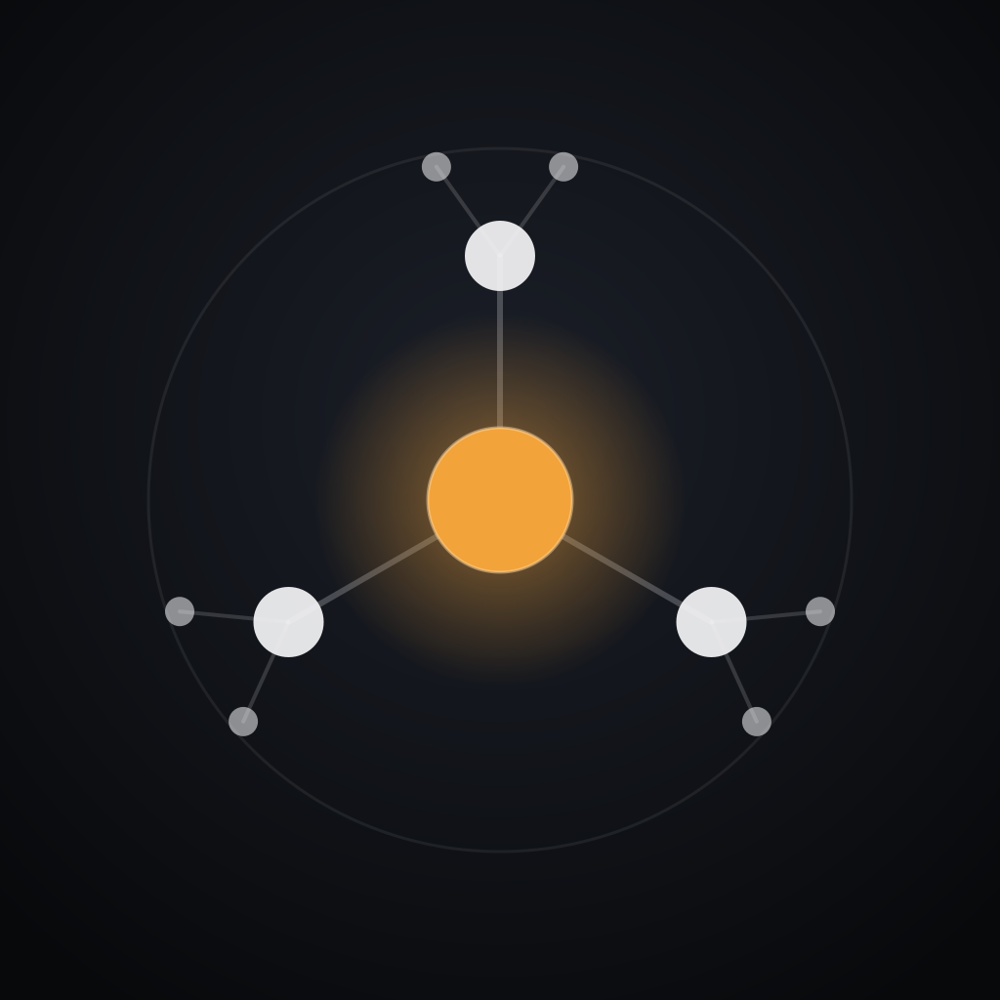
</p>

<h1 align="center">Sofia Cortex</h1>

<p align="center"><b>English</b> · <a href="README.tr.md">Türkçe</a></p>

<p align="center">
  A notes and tasks app with the simplicity of Apple Notes.<br/>
  Write, format, step inside, split, check off, and when it is time to get things done, focus on one thing.
</p>

<p align="center">
  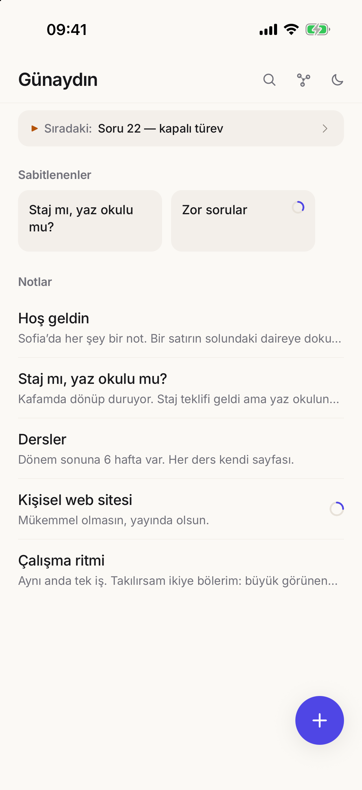
  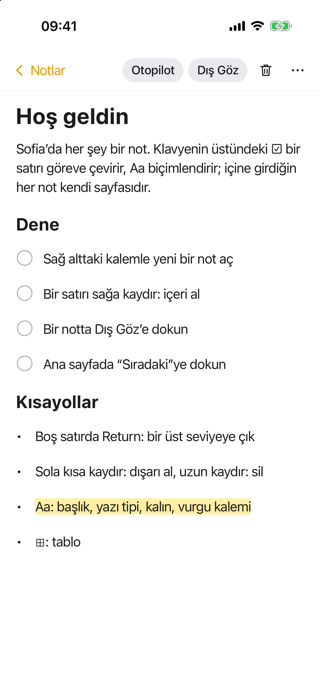
  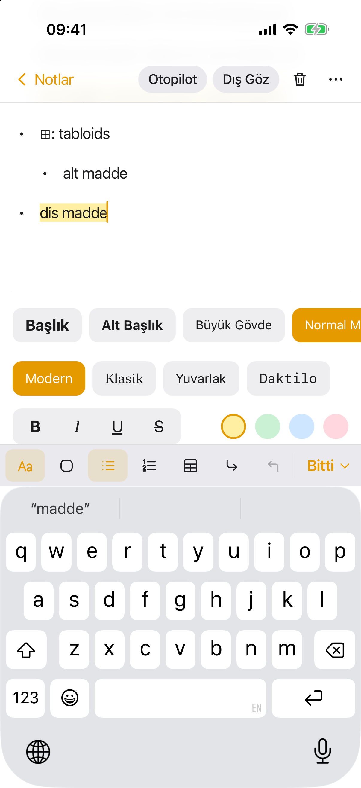
  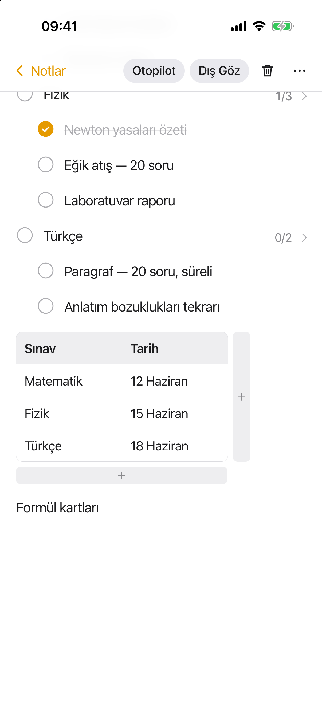
</p>

---

The app's interface is in Turkish; the on-screen labels are given in parentheses below.

## Idea

Everything is a note. A note can be a task; when you step inside it, it becomes its own page, and you
add new notes and tasks inside it. There is no limit to the depth. When all subtasks are done, the
task above them checks itself off; if one of them is reopened, so is the parent.

Two small habits make the work easier:

- **Outside Eye (Dış Göz)**: you read your note laid out like a book page, as if you were reading
  someone else's writing. Below it is a single question: *"What is the smallest concrete step you
  could take right now?"* Every step you write is added as a task under that note.
- **Autopilot (Otopilot)**: only the next single task stays on the screen. You press
  *Done (Tamamlandı)* and the next one comes up on its own. If it turns out to be too big,
  *Split in two (İkiye böl)*.

No AI, no account, no server. Everything is on the phone, in SQLite.

## Screens

<table>
<tr>
<td width="33%"><br/><sub><b>Home.</b> Pinned (Sabitlenenler), Today (Bugün), Previous 7 Days (Önceki 7 Gün)… in grouped boxes. Each row shows the title, a task counter, the time and a preview of its contents. Search and the new-note pencil at the bottom.</sub></td>
<td width="33%">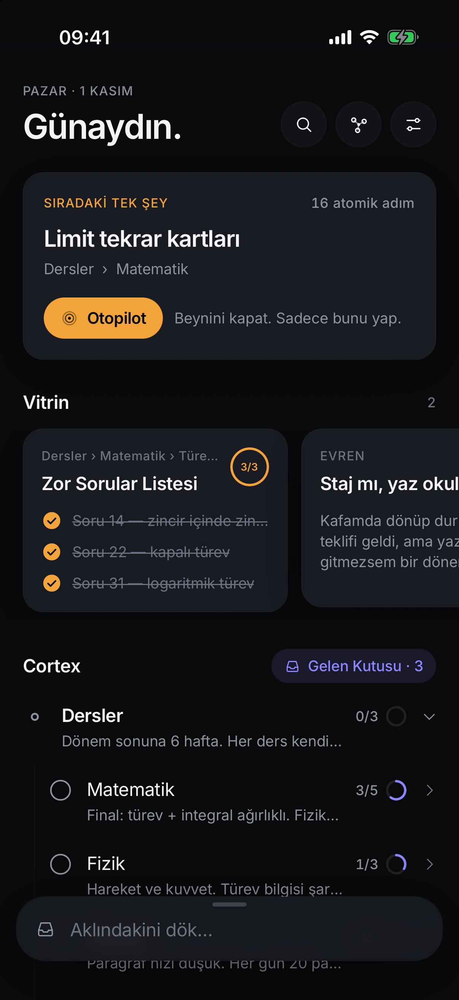<br/><sub><b>Dark theme.</b> Pure black background, #1C1C1E boxes. The moon/sun at the top right; press and hold it for Settings (Ayarlar).</sub></td>
<td width="33%"><br/><sub><b>Note.</b> Plain lines have no marker next to them; only tasks get a circle, and lists get a bullet or number.</sub></td>
</tr>
<tr>
<td>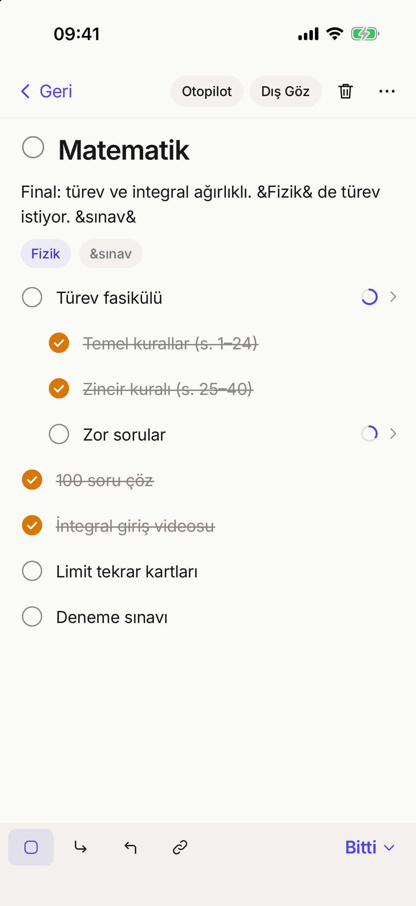<br/><sub><b>While typing.</b> Scrollable tools above the keyboard: Aa · ☑ · • · 1. · ⊞ · Indent (İçeri al) · Outdent (Dışarı çık) · Link (Bağla), with a fixed Done (Bitti) on the right.</sub></td>
<td><br/><sub><b>Aa.</b> Title (Başlık), Heading (Alt Başlık), Large Body (Büyük Gövde), Body (Normal Metin), Code (Kod); Modern / Classic (Klasik) / Rounded (Yuvarlak) / Typewriter (Daktilo); B I U S and four highlighter colors.</sub></td>
<td><br/><sub><b>Table.</b> Inserted with ⊞; cells are edited in place, ＋ adds a row or column, and while focused you can delete a row, column or the whole table.</sub></td>
</tr>
<tr>
<td>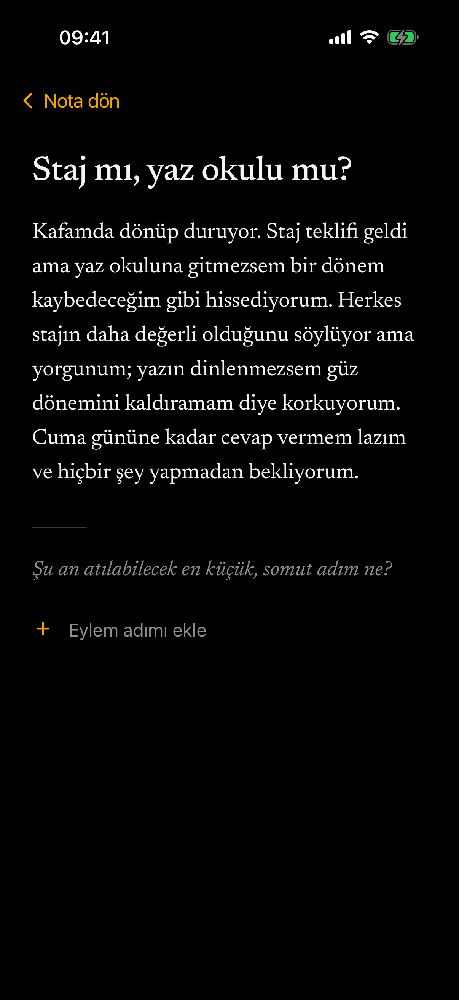<br/><sub><b>Outside Eye.</b> Your own note, untouched, like a book page. Below it, a single question and the action steps.</sub></td>
<td>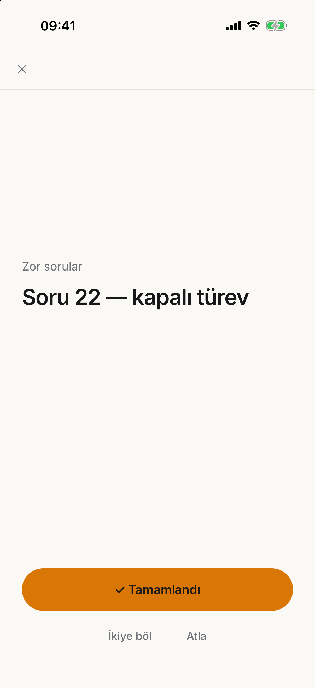<br/><sub><b>Autopilot.</b> One task. Done · Split in two · Skip (Atla).</sub></td>
<td>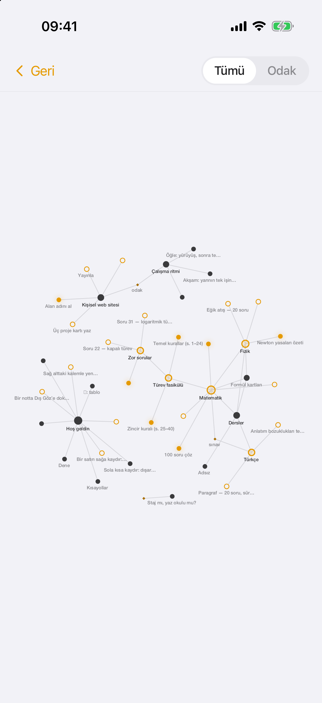<br/><sub><b>Graph.</b> Notes and the links between them. Once it settles into balance, the physics stops.</sub></td>
</tr>
<tr>
<td>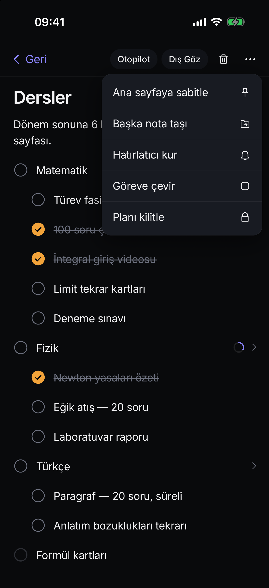<br/><sub><b>••• menu.</b> Pin, move, reminder, task/note, lock the plan. A numbered list counts itself.</sub></td>
<td>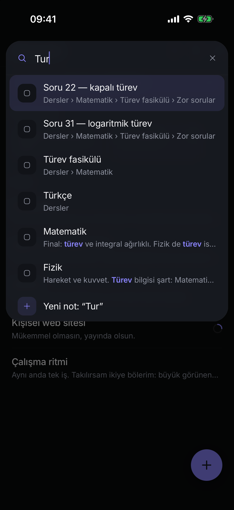<br/><sub><b>Search.</b> Diacritic-insensitive: typing “tur” also finds “Türev”.</sub></td>
<td></td>
</tr>
</table>

## Usage

| | |
|---|---|
| New note | The pencil at the bottom right of the home screen. The title is ready to type; Return moves to the body. A note left empty deletes itself. |
| Task | ☑ in the keyboard bar. Only then does the circle appear; press ☑ again and it disappears completely and the line goes back to plain text. |
| List | • (bulleted) and 1. (numbered). Return starts a new line of the same kind. |
| Format | Aa: paragraph style, font, bold/italic/underline/strikethrough, highlighter. Formatting applies to the whole line. |
| Table | ⊞. Tap a cell and type; the ＋ on the right adds a column, the ＋ at the bottom adds a row. |
| Indent / outdent | Swipe the line right or tap ↳: indent. **Return on an empty line** or **⌫ at the start of a line**: move out one level. A short swipe left or ↰ also outdents. |
| Delete | Long swipe the line left, or use the trash can in the top bar. The *Undo (Geri al)* that appears right away brings it back with one tap. |
| Link | *Link* in the keyboard bar, or type `&`: `&Fizik&`. If a note with that name exists it becomes a link; otherwise it becomes a tag. |
| Pin, move, reminder | The ••• in the note's top bar. If you choose, tapping the reminder notification opens it directly in Autopilot. |
| Lock the plan | ••• → Lock the plan (Planı kilitle). Until the tasks are done, the order and structure stay fixed and tasks can only be checked off (formatting is still free). |

## Architecture

```
Expo SDK 58 · React Native 0.88 (New Architecture) · TypeScript strict
expo-sqlite (WAL + FTS5) · @shopify/react-native-skia (graph) · San Francisco (system font)
Reanimated 4 · Gesture Handler 3 · react-native-keyboard-controller
```

The engine (`src/engine`) is pure TypeScript; it contains no React or Expo and reaches storage through
a four-method interface: expo-sqlite on the phone, `bun:sqlite` in tests. SQLite is the source of
truth; screens read everything synchronously from an in-memory copy, so no frame ever waits on disk.
Every change is saved as a single transaction, which is what makes undo / redo a single step.

Details: [`ARCHITECTURE.md`](ARCHITECTURE.md) · working rules: [`CLAUDE.md`](CLAUDE.md) ·
design direction: [`docs/design-direction.md`](docs/design-direction.md)

**Measured performance (10 000 notes):** load at startup ~15 ms · check-off and upward propagation ~0.07 ms ·
search ~0.9 ms · graph physics step ~6 ms. `bun test` → 115 tests.

## Setup

Requirements: macOS, Xcode, Node ≥ 20, CocoaPods, [bun](https://bun.sh) (for tests).

```bash
git clone https://github.com/cleoanka/sofia-cortex.git
cd sofia-cortex
npm install
bun test
npx expo run:ios                     # simulator
```

`npm test` and `npm run typecheck` run the tests and the strict type check; GitHub Actions
(`.github/workflows/ci.yml`) runs both on every push and pull request to `main`.

### Installing on an iPhone

1. Connect the iPhone over USB and tap *Trust This Computer*; turn on **Settings → Privacy & Security →
   Developer Mode**.
2. In `app.json` → `expo.ios.appleTeamId`, enter your own Team ID and make `bundleIdentifier` unique.
   A free Apple account works too: the app only uses local notifications, and
   `plugins/withLocalNotificationsOnly.js` removes the push entitlement.
3. Build and install:
   ```bash
   npx expo prebuild --platform ios
   cd ios && xcodebuild -workspace SofiaCortex.xcworkspace -scheme SofiaCortex \
     -configuration Release -destination "id=<UDID>" -allowProvisioningUpdates build
   xcrun devicectl device install app --device <UDID> build/Build/Products/Release-iphoneos/SofiaCortex.app
   ```
4. On first launch, trust your developer certificate under **Settings → General → VPN & Device Management**.

## How it was built

Claude Opus 5.5 wrote the app and checked every screen with screenshots in the simulator (with the
real on-screen keyboard). Through `agy`, **Gemini 4 Argon** reviewed every major change to hunt for
bugs (the issues it found were fixed), and produced the physics engine, an architecture/performance review
([`docs/design-review-2026-11-01.md`](docs/design-review-2026-11-01.md)) and the minimal design direction
([`docs/design-direction.md`](docs/design-direction.md)); **Gemini 3.8 Flash** wrote the edge-case and
format/table tests.

## License

MIT
