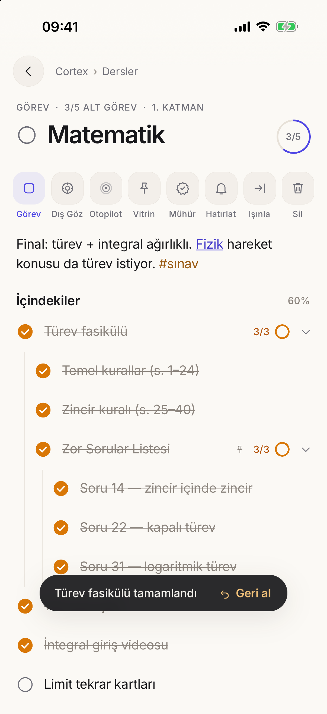
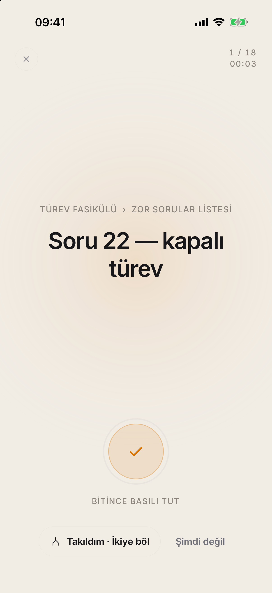
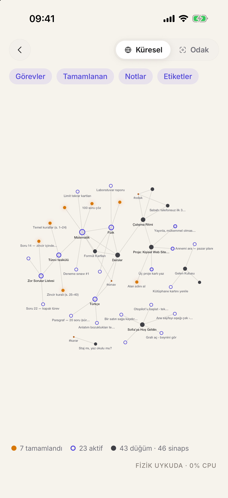
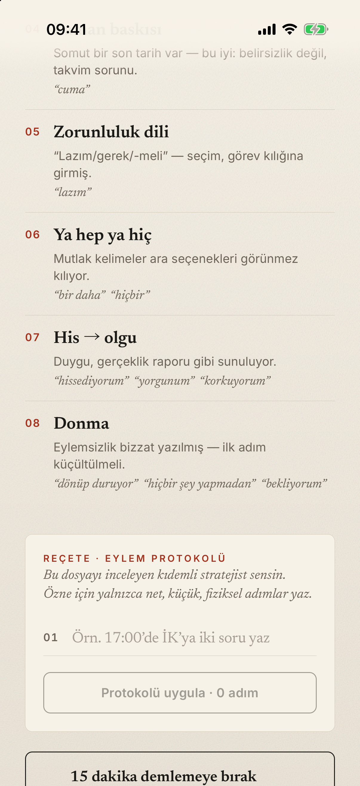
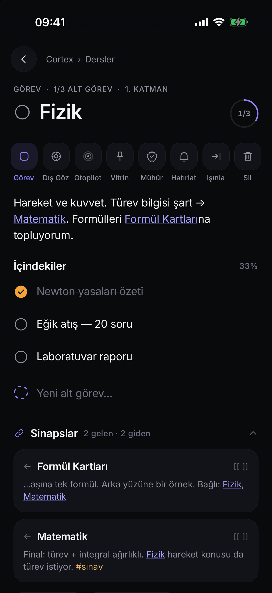
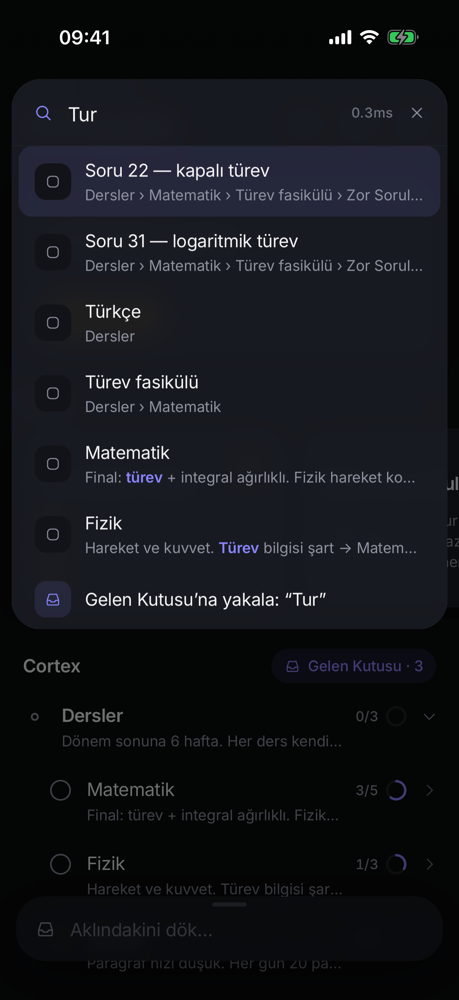

<p align="center">
  
</p>

<h1 align="center">Sofia Cortex</h1>

<p align="center">
  <b>Fraktal bir düşünce, not ve görev motoru.</b><br/>
  Kaotik düşünceyi yakalar, sonsuz derinlikte yapılandırır, aralarındaki ağı gösterir —<br/>
  ve iş yapma zamanı geldiğinde <i>beynini kapatıp</i> otopilotta ilerlemeni sağlar.
</p>

<p align="center">
  
  
  
  
</p>

---

## Felsefe

İnsan başkasına akıl vermekte ustadır, kendi sorununu çözmekte acemi (Solomon paradoksu).
ADHD ve OKB zihinleri için en yıkıcı şey, tek bir işi yaparken diğer elli işi ve tüm ağacı
görmek; mükemmeliyetçi zihin için ise listeyi düzenlemekten işi yapmaya geçememek.

Sofia bu üç kırılmayı **yapay zekâ olmadan** — deterministik algoritmalar, tipografik ve
mekânsal yabancılaştırma, kusursuz bilgi mimarisi ve dokunsal geri bildirimle — çözer.

| | |
|---|---|
| **Tek atom** | Klasör, not, görev, alt görev yok. Her şey bir `CortexNode`. Not olur, tek dokunuşla göreve döner, içine girince koca bir sayfaya dönüşür. Derinlik sınırsız. |
| **Aşağıdan yukarı yayılım** | “Matematik”in 5 alt görevinin sonuncusunu tiklediğin an halka kapanır, 120 ms sonra ebeveyn kendini tikler ve dalga en üste kadar yürür. Biri geri açılırsa ebeveyn zarifçe `4/5`'e döner. |
| **Dış Göz** | Kendi notun, bir dergide yayımlanmış bir vaka dosyası gibi yeniden dizilir: serif tipografi, kâğıt dokusu, *birinci şahıs → üçüncü şahıs* aktarımı, “Özne”, gözlemlenen döngü örüntüleri. Altına yalnızca bir stratejistin yazacağı şeyi yazarsın: reçete. Her satır gerçek bir alt göreve dönüşür. |
| **Otopilot** | Her şey karanlığa gömülür. Ekranda yalnızca sıradaki **tek** atomik görev ve yavaş nefes alan bir ışık. Bitince basılı tut — kart erir, sıradaki kendiliğinden gelir. Büyük mü geldi? *İkiye böl.* |
| **Planı mühürle** | Plan hazırsa mühürle: yeniden sıralama ve yapı kilitlenir, yalnızca yürütme açık kalır. Son görev bitince mühür kendiliğinden çözülür. |
| **Gelecekteki kendine komut** | Bildirim yerine *Otopilot kancası*: bildirime dokunduğun an uygulama ana sayfayı bile göstermeden doğrudan o görevin tek-görev ekranında açılır. |

## Ekranlar

<table>
<tr>
<td width="33%"><br/><sub><b>Ana Vitrin · Kağıt.</b> Sıradaki tek şey, 4 katman derinden vitrine çıkarılmış portal (üzerindeki tik asıl yerinde de tiklenir), fraktal ağaç, Hızlı Döküm.</sub></td>
<td width="33%"><br/><sub><b>Ana Vitrin · Karbon.</b> OLED dostu derin obsidyen, yükseltilmiş yüzeylerde 1px speküler kenar.</sub></td>
<td width="33%"><br/><sub><b>Aşağıdan yukarı yayılım.</b> Soru 22 + 31 tiklendi → Zor Sorular ✓ → Türev fasikülü ✓ → Matematik 3/5. Tek adımda geri alınabilir.</sub></td>
</tr>
<tr>
<td><br/><sub><b>Cortex Web.</b> Tek Skia katmanı, Barnes-Hut fiziği; dengeye ulaşınca <i>uykuya geçer (0 % CPU)</i>. Tamamlanan / aktif / engelli ayrımı, Küresel ↔ Odak merceği.</sub></td>
<td><br/><sub><b>Dış Göz.</b> Vaka №, gözlem kaydı, üçüncü şahıs aktarımı: “Özne yorgun ve yazın dinlenmezse güz dönemini kaldıramaz diye korkuyor.”</sub></td>
<td><br/><sub><b>Gözlemlenen örüntüler + Reçete.</b> Salınım, felaketleştirme, toplumsal kanıt, zaman baskısı, zorunluluk dili, ya-hep-ya-hiç… Her reçete satırı bir alt görev.</sub></td>
</tr>
<tr>
<td><br/><sub><b>Otopilot.</b> Tek görev, nefes alan ışık, basılı-tut-tamamla, İkiye böl.</sub></td>
<td><br/><sub><b>Fraktal düğüm.</b> Görünür araç satırı (gizli menü yok), zengin gövde, <code>[[sinaps]]</code>, ilerleme halkası.</sub></td>
<td><br/><sub><b>Komut Paleti.</b> Aşağı çek. FTS5 ile milisaniyenin altında arama; <code>&gt; Matematik: Deneme çöz</code> gibi komutlar.</sub></td>
</tr>
</table>

## Özellikler

- **Evrensel fraktal düğüm** — sonsuz derinlik, akışkan kimlik (not ⇄ görev ⇄ sayfa), sağa kaydır = içeri al, sola = dışarı al, daha sola = hatırlat, uzun bas-sürükle = başka bir düğümün *içine* bırak (hedef nabız gibi atar), iki parmakla kıstır = tümünü katla/aç.
- **Reaktif yayılım** — alttan üste otomatik tikleme ve geri açılma, mikro-animasyonlu ilerleme halkaları, `Success` + ağır çift darbe haptic.
- **Vitrin (Pin to Home)** — hiyerarşiden koparmadan derin düğümü Ana Sayfa'ya portal olarak çıkar.
- **Çift yönlü sinapslar** — `[[Not]]`, `[[Not|takma ad]]`, `@Görev`, `#etiket`; `[[` yazınca otomatik tamamlama; bağlamlı *Gelen bağlantılar* çekmecesi; yeniden adlandırınca tüm referanslar güncellenir.
- **Cortex Web** — GPU'da tek katman graf, Barnes-Hut (10 000 düğüm / 12 000 kenarda ≈ 6 ms/adım), uyku modu, sürükle-uyandır, Küresel / Odak (1.–2. derece) merceği, filtreler.
- **Dış Göz** — tipografik + mekânsal yabancılaştırma, deterministik Türkçe 1.→3. şahıs aktarımı, sis endeksi, döngü örüntüleri, **15 dakika demlemeye bırak** (kilitlenir, bildirimle vaka dosyası olarak geri gelir), Eylem Protokolü → alt görevler.
- **Otopilot** — tünel modu, tek atomik görev, nefes ritmi, basılı tut, *İkiye böl*, *Şimdi değil*, odak sayacı.
- **Planı mühürle** — OKB döngü kırıcı.
- **Chrono-trigger'lar** — not/görev başına bildirim; *Otopilot kancası* soğuk açılışta bile doğrudan tek-görev ekranını açar.
- **Cortex Dump** — alttan yukarı çekilen Hızlı Döküm; her şey Gelen Kutusu'na, sonra *Işınla*.
- **Komut Paleti** — aşağı çek; FTS5 (aksan-duyarsız, önek), `>` komutları, ışınlama modu.
- **Zaman yolculuğu** — her işlem tek adım undo/redo; cam kapsül *Geri al*; telefonu salla = geri al; 30 gün saklayan çöp kutusu.
- **Veri egemenliği** — tek dokunuşla **Markdown kasası (.zip, Obsidian'da açılır)** veya JSON; içe aktar (birleştir / değiştir). Sunucu yok, hesap yok.
- **Yaşayan başlangıç** — ilk açılışta boş ekran yok: Dersler (Matematik/Fizik/Türkçe), mühürlü bir plan, Dış Göz için bir karar notu, etkileşimli hoş geldin görevleri.

## Mimari

```
Expo SDK 58 · React Native 0.88 (New Architecture) · TypeScript strict
expo-sqlite (WAL + FTS5 + recursive CTE) · @shopify/react-native-skia 2
Reanimated 4 + react-native-worklets · Gesture Handler 3 (hook API)
expo-haptics · expo-notifications · zustand
```

Motor (`src/engine`) saf TypeScript'tir — React ya da Expo import etmez, depolamaya dört metotluk
bir `SqlDriver` üzerinden erişir; cihazda expo-sqlite, testlerde `bun:sqlite`. SQLite gerçeğin
kaynağıdır; artımlı indeksli bir bellek aynası her UI okumasını senkron yanıtlar, böylece **hiçbir
kare I/O beklemez**. Her yazma `transact()` içinde koşar: önce/sonra anlık görüntüsü alınır, tek
SQLite işleminde kalıcılaştırılır, undo/redo = anlık görüntüyü yeniden uygulamak.

Ayrıntılar: [`ARCHITECTURE.md`](ARCHITECTURE.md) · çalışma kuralları: [`CLAUDE.md`](CLAUDE.md)

### Ölçülen performans (10 000 düğüm)

| işlem | süre |
|---|---|
| soğuk yükleme (SQLite → bellek + indeksler) | ~15 ms |
| tikleme + tam yayılım dalgası + kalıcılaştırma | ~0.07 ms |
| FTS5 önek araması | ~0.9 ms |
| Otopilot kuyruğu | ~0.2 ms |
| graf projeksiyonu | ~6 ms |
| Barnes-Hut adımı (10k düğüm / 12k kenar) | ~6 ms |

`bun test` → **78 test** (motor, 52 adversarial edge-case, gözlemci dilbilimi, fizik).

## Kurulum

Gereksinimler: macOS, Xcode (iOS 26 SDK), Node ≥ 20, CocoaPods, [bun](https://bun.sh) (testler için).

```bash
git clone https://github.com/cleoanka/sofia-cortex.git
cd sofia-cortex
npm install
bun test                     # motor + fizik + dilbilim testleri
```

### iOS Simülatör

```bash
npx expo run:ios             # dev build: derler, simülatöre kurar, Metro'yu başlatır
```

### Fiziksel iPhone (ör. iPhone 12)

1. iPhone'u USB ile bağla (veya aynı ağda Wi-Fi eşleştirmesi), *Bu bilgisayara güven* de.
   iPhone'da **Ayarlar → Gizlilik ve Güvenlik → Geliştirici Modu**'nu aç.
2. `app.json` → `expo.ios.appleTeamId` alanına kendi Apple Developer Team ID'ni yaz
   (ücretsiz Apple ID de olur) ve `bundleIdentifier`'ı benzersiz yap.
3. Cihazı bul ve derle:
   ```bash
   xcrun devicectl list devices
   npx expo run:ios --device <UDID> --configuration Release   # Mac'e bağlı olmadan çalışan sürüm
   # ya da geliştirme için:
   npx expo run:ios --device <UDID>
   ```
4. İlk kurulumda iPhone'da **Ayarlar → Genel → VPN ve Cihaz Yönetimi** altında geliştirici
   sertifikana güven.

### Derin bağlantılar

`sofia://home` · `sofia://node/<başlık>` · `sofia://observer/<başlık>` · `sofia://autopilot` ·
`sofia://graph` · `sofia://settings`

```bash
xcrun simctl openurl booted "sofia://observer/Staj%20m%C4%B1%2C%20yaz%20okulu%20mu%3F"
```

## Yapay zekâ yuvası

Bugün hiçbir model çağrılmaz. `CortexAIProvider` arayüzü (`suggestSteps`, `reframe`) yerel ya da bulut
bir modelin tek bir adaptörle, motora dokunmadan takılabilmesi için hazır bekler.

## Lisans

MIT

## Nasıl inşa edildi

Çok-modelli bir orkestrasyonla: Claude Opus 5.5 baş mimar olarak motoru, UI'ı ve görsel doğrulama
döngüsünü yazdı; `agy` üzerinden **Gemini 4 Argon** Barnes-Hut fizik motorunu ve ardından 34 bulguluk
adversarial mimari/performans/UX incelemesini ([`docs/design-review-2026-11-01.md`](docs/design-review-2026-11-01.md)),
**Gemini 3.8 Flash** 52 edge-case testini üretti. Her bulgu doğrulandı, uygulandı ve simülatörde ekran
görüntüsüyle yeniden kontrol edildi.

> Ücretsiz (kişisel) Apple takımıyla imzalama: Sofia yalnızca *yerel* bildirim kullanır;
> `plugins/withLocalNotificationsOnly.js` push yetkisini kaldırır, böylece ücretsiz hesapla da cihaza kurulur.
